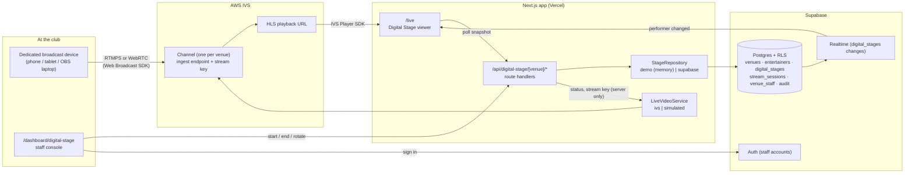

# Digital Stage — setup and architecture

Digital Stage gives each nightclub **one** livestream that entertainers rotate through, the way
performers rotate on a physical stage. Visitors watch on the club's own website, see
"LIVE NOW: Goldie", see who's up next, and can reserve a VIP table without leaving the page.

This document covers: how it works, demo mode, Supabase, AWS IVS, broadcasting, performer
rotation, deployment, onboarding more venues, and the security/compliance items that must be
settled before production.

---

## 1. Architecture



**Key separation**

| Concern | Where | Notes |
|---|---|---|
| Video bytes | AWS IVS only | The app never proxies video. |
| "Who is on stage" | Postgres (`digital_stages`) | Authoritative, changed only through SQL functions that check staff membership and performer consent. |
| Live/offline (venue) | `digital_stages.is_live` | What staff declared. |
| Live/offline (feed) | IVS `GetStream` via the server | Whether bytes are actually flowing; shown as "waiting for the camera feed" when they differ. |
| Secrets | Server env vars + IVS | AWS keys never leave the server. Stream keys are never stored in the DB; they are fetched from IVS on demand, over an authenticated route, and every reveal is audited. |

Code map:

```
src/lib/digital-stage/
  types.ts               domain types + StageRepository interface
  mode.ts                demo vs production decided from env (server only)
  repository.ts          picks demo-repository or supabase-repository
  demo-repository.ts     in-memory state for demo mode
  supabase-repository.ts Postgres-backed state via RLS + SQL functions
  video.ts               picks the real IVS service or the simulation
  auth.ts                requireStaff(venue) for routes and pages
  http.ts                staffRoute() wrapper: validation, rate limit, errors
src/lib/ivs/
  types.ts               LiveVideoService interface
  service.ts             AWS IVS via @aws-sdk/client-ivs (server only)
  simulated.ts           demo stand-in
src/app/api/digital-stage/[venue]/
  route.ts               GET public snapshot
  rotation/route.ts      POST staff: active / next / queue
  broadcast/route.ts     POST staff: start | end
  stream-key/route.ts    POST staff: reveal ingest endpoint + key (audited)
  activity/route.ts      GET staff: sessions + audit
src/app/live/page.tsx                    viewer page
src/app/dashboard/digital-stage/page.tsx staff console
src/app/dashboard/login/                 staff sign-in (production only)
src/components/digital-stage/            StagePlayer, NowPerforming, VenueInfo, AgeGate, dashboard/*
supabase/migrations/20260101000000_digital_stage.sql   schema, RLS, functions, realtime
supabase/seed.sql                        ONYX demo venue for local Supabase
src/proxy.ts                             session refresh + /dashboard redirect (production only)
```

---

## 2. Run demo mode (no AWS, no Supabase)

```bash
npm install
npm run dev
```

With no `.env.local`, the app starts in **demo mode**:

- `/live` shows the stage with a clearly labelled *simulated* video placeholder.
- `/dashboard/digital-stage` is open (no sign-in) and says so. Pick Goldie as "Performing now",
  press **Start broadcast**, then switch to Sapphire, set who's up next, and watch `/live`
  (open it in a second tab or on your phone) update within a few seconds.
- State lives in the server's memory: it is shared by every browser talking to that server and
  resets when the dev server restarts.
- Raven is seeded *without* broadcast consent to show the gate: she cannot be put on stage.

To force demo mode even with credentials present, set `DIGITAL_STAGE_MODE=demo`.

---

## 3. Configure Supabase (production state + staff auth)

1. Create a project at supabase.com (or run one locally: `npx supabase init`, then
   `npx supabase start`).
2. Apply the migration:
   - Local: `npx supabase db reset` (applies `supabase/migrations/*` and `supabase/seed.sql`).
   - Cloud: `npx supabase link --project-ref <ref>` then `npx supabase db push`.
     Do **not** push the demo seed to a real venue's project; onboard real venues as in §9.
3. In `.env.local` set `NEXT_PUBLIC_SUPABASE_URL` and `NEXT_PUBLIC_SUPABASE_ANON_KEY`
   (Project Settings → API). `SUPABASE_SERVICE_ROLE_KEY` is only needed for operator scripts.
4. Create staff accounts: Authentication → Users → *Add user* (email + password; disable public
   sign-ups in Auth settings), then grant venue access:
   ```sql
   insert into public.venue_staff (venue_id, user_id, role)
   select id, '<auth user uuid>', 'owner' from public.venues where slug = 'onyx';
   ```
   Roles: `owner` (manage staff and venue), `manager` (manage entertainers and venue details),
   `broadcaster` (run the stage). All three can start/end/rotate.
5. Restart `npm run dev`. The dashboard now requires sign-in at `/dashboard/login`, and the
   viewer page reads from Postgres and receives Realtime updates.

Regenerate TypeScript types after changing the schema:
`npx supabase gen types typescript --local --schema public > src/types/database.ts`
(then re-add the aliases at the bottom of that file).

---

## 4. Create an AWS IVS channel

1. AWS Console → **Amazon IVS** → *Low-latency streaming* → **Create channel**.
   - Name: the venue slug (e.g. `onyx`).
   - Channel type: **Standard** (transcodes to multiple renditions; what phones on cellular need).
     *Basic* is cheaper but single-rendition; the Web Broadcast SDK works with both.
   - Latency: Low. Recording: off for now (see §10 for where it plugs in).
2. After creation copy from the channel page:
   - **Channel ARN** → `venues.aws_ivs_channel_arn` (and/or `AWS_IVS_CHANNEL_ARN` for the default venue)
   - **Playback URL** → `venues.aws_ivs_playback_url` (and/or `AWS_IVS_PLAYBACK_URL`)
   - **Ingest server** → `venues.aws_ivs_ingest_endpoint` (optional cache; the server also reads it from IVS)
3. Create an IAM user (or role) for the app with a policy limited to the channels you own:
   ```json
   {
     "Version": "2012-10-17",
     "Statement": [{
       "Effect": "Allow",
       "Action": ["ivs:GetChannel", "ivs:GetStream", "ivs:ListStreamKeys", "ivs:GetStreamKey", "ivs:StopStream"],
       "Resource": ["arn:aws:ivs:<region>:<account>:channel/*", "arn:aws:ivs:<region>:<account>:stream-key/*"]
     }]
   }
   ```
   `ivs:CreateChannel` is only needed if you automate onboarding (§9).

## 5. Where to insert AWS credentials

Only in server environment variables. Locally in `.env.local` (git-ignored); on Vercel in
Project → Settings → Environment Variables. Never in code, never with a `NEXT_PUBLIC_` prefix.

```env
AWS_REGION=us-east-1
AWS_ACCESS_KEY_ID=...
AWS_SECRET_ACCESS_KEY=...
AWS_IVS_CHANNEL_ARN=arn:aws:ivs:...:channel/...      # default venue fallback
AWS_IVS_PLAYBACK_URL=https://....m3u8                 # default venue fallback
```

On AWS-hosted infrastructure you can set `AWS_USE_DEFAULT_CREDENTIAL_CHAIN=true` and attach an
IAM role instead of keys. Once `AWS_REGION` and credentials are present, the dashboard shows
real feed status and can reveal the stream key; the viewer page uses the IVS Player SDK.

The server never makes an AWS call unless these are set; without them it reports
"AWS IVS is not configured" rather than guessing.

---

## 6. Connect the broadcaster

Use a **dedicated, consent-based broadcast device** on a tripod: never a security/CCTV feed.
Two paths, both driven from `/dashboard/digital-stage`:

**A. Encoder app (recommended): OBS, Streamlabs, Larix, Prism**
1. Dashboard → *Connect the camera* → **Reveal stream key**. The key is fetched from IVS at that
   moment, shown masked for 60 seconds, never stored by the app, and the reveal is written to the
   venue's audit log.
2. In the encoder choose *Custom* service; Server = the RTMPS URL shown; Stream key = the key.
   Suggested: 1280×720, 30 fps, 2.5–4 Mbps, keyframe interval 2 s.
3. Press **Start broadcast** in the dashboard (marks the stage live, opens a performer session),
   then *Start Streaming* in the encoder. Viewers see video in a few seconds.
4. Leave the encoder running all night; rotate performers from the dashboard.
5. **End broadcast** marks the stage offline and asks IVS to disconnect the encoder.

**B. Browser broadcasting (Amazon IVS Web Broadcast SDK)**
The dashboard's *Broadcast from this device* panel uses the official `amazon-ivs-web-broadcast`
package (WebRTC ingest to a low-latency channel) with the camera preview as its source.
Trade-off, stated plainly: the SDK must hold the stream key on the broadcasting device. The app
limits that to the signed-in staff browser, fetches the key over the audited route only when
staff press *Go live*, keeps it in memory, and never persists it. If a venue is not comfortable
with that, use path A. This path is wired but **has not been exercised against a real channel**
in this scaffold (no AWS credentials were available); treat the first live test as a verification
step.

## 7. Connect the playback URL

Set `venues.aws_ivs_playback_url` for the venue (or `AWS_IVS_PLAYBACK_URL` for the default
venue). `/live` loads the official IVS Player SDK from `player.live-video.net` (version pinned by
`NEXT_PUBLIC_IVS_PLAYER_VERSION`, default 1.25.0), attaches it to a `<video>` element and plays
the URL whenever the stage is marked live. If the channel is offline the player reports
"waiting for the video feed" instead of showing an error.

The `<video>` element stays mounted while performers change; only the panels around it update,
so a rotation never interrupts playback.

---

## 8. How performer rotation works

The stream and the "who is on stage" record are independent:

```
digital_stages
  is_live                 staff pressed Start/End
  active_entertainer_id   LIVE NOW: …
  next_entertainer_id     Up next
  rotation_queue[]        after that
stream_sessions           one row per performer per stint (started_at / ended_at)
```

- **Start broadcast** → `start_stage_broadcast()`: sets `is_live`, puts the chosen performer
  (or the one marked *next*) on stage, opens a `stream_sessions` row, promotes the queue.
- **Change performer** → `set_stage_rotation()`: swaps `active_entertainer_id`, closes the
  previous performer's session, opens a new one. `is_live` is untouched; the encoder keeps
  sending video.
- **End broadcast** → `end_stage_broadcast()`: clears the active performer, closes the session.
- Every function checks: caller is `venue_staff` of that venue; the performer belongs to the
  venue, is active, and has `broadcast_consent_at` set. Each call is written to `stage_audit_log`.
- Viewers get the change via Supabase Realtime (`digital_stages` UPDATE) and, as a fallback, an
  8-second poll of `GET /api/digital-stage/<venue>`.

---

## 9. Deploy to Vercel

1. Push the branch and import the repo in Vercel (framework: Next.js, no special build settings).
2. Add the environment variables from `.env.example` for Production (and Preview if wanted).
3. Supabase: Authentication → URL configuration → add the Vercel URL to *Site URL / Redirect URLs*.
4. Deploy. Check `/live` (player loads, status reads "offline" until the encoder starts) and
   `/dashboard/login`.
5. Vercel serverless functions are stateless: the in-memory rate limiter and demo mode are
   per-instance. Production relies on Supabase for state; add a Vercel WAF / edge rate limit
   rule for `/api/digital-stage/*/(broadcast|rotation|stream-key)` before opening to the public.

## 10. Onboard another venue

The same codebase serves every club; a venue is a row, not a fork.

1. `insert into public.venues (name, slug, city, address, primary_color, secondary_color, age_restriction, aws_ivs_channel_arn, aws_ivs_playback_url) values (...)`.
2. `insert into public.digital_stages (venue_id) values (<venue id>)`.
3. Add entertainers (`entertainers` rows; set `broadcast_consent_at` only after the performer
   has signed the consent form).
4. Create staff auth users and `venue_staff` rows.
5. Create an IVS channel for the venue (§4) and store its ARN and playback URL on the row.
6. Point a deployment at it with `NEXT_PUBLIC_DEFAULT_VENUE_SLUG=<slug>` (one deployment per
   venue today). Serving many venues from one deployment by host name is the next step: resolve
   the slug from the request host in `proxy.ts` and pass it to the pages instead of
   `DEFAULT_VENUE_SLUG`; nothing in the data layer needs to change.

Site-level branding (colors, hours, menu, shop) still comes from `src/config/venue.ts`; the
Digital Stage reads venue name/address/colors from the database so the stage itself is not tied
to ONYX.

---

## 11. Security and compliance checklist

Built in:
- RLS on every table; public reads go through `venues_public` and permissive SELECT policies that
  contain no credentials; one venue's staff cannot read or change another venue's rows.
- All stage writes go through `security definer` functions that re-check staff membership and
  performer consent, and append to `stage_audit_log` (update/delete/truncate are blocked by
  triggers).
- AWS credentials and the Supabase service-role key are server-only; stream keys are fetched on
  demand, shown masked, auto-hidden, never stored, every reveal audited.
- Input validation on every route; per-client rate limits on mutations (tightest on stream-key).
- Explicit performer opt-in (`broadcast_consent_at` / `_version`); age gate configurable per
  venue (`venues.age_restriction`).
- Dedicated broadcast devices only; the app has no way to attach CCTV.

Must be settled before production (not done here):
- **AWS service terms and content eligibility**: confirm with AWS that adult-entertainment
  streaming is permitted under the IVS / AWS Acceptable Use Policy for your content.
- **Laws**: performer consent and recording laws in each state/country, 18 U.S.C. §2257-style
  record-keeping if applicable, age-verification requirements for viewers (the age gate here is
  an acknowledgement, not verification), local ordinances on nightlife broadcasting.
- **Payment-provider policies** before adding tipping/paid streams: many processors restrict
  adult content.
- Staff MFA, session policies, a WAF/edge rate limit, log retention, backup/restore, and a
  penetration test.
- Moderation: a way to cut the feed instantly (End broadcast does this), who may do it, and
  incident records.
- Recording/retention policy before enabling IVS recording.

## 12. Future features (where they plug in)

| Feature | Hook |
|---|---|
| Individual entertainer streams / multiple simultaneous streams | one `ChannelInfo` per entertainer behind `LiveVideoService`; a `streams` table keyed by entertainer instead of `digital_stages` (one per venue) |
| Viewer chat | Supabase Realtime broadcast channel per stage; moderation via `venue_staff` |
| Tipping / paid private streams | payment provider + `stream_sessions` for attribution; IVS private channels use playback authorization tokens |
| Stream analytics | `stream_sessions` + IVS `viewerCount` sampled by a cron job |
| Venue billing | a `subscriptions` table keyed by `venue_id` |
| Custom domains | host → venue slug resolution in `proxy.ts` |
| Recordings / highlights | IVS RecordingConfiguration on the channel + an S3 bucket; store the key on `stream_sessions` |

## 13. Verification performed in this scaffold

- `tsc --noEmit`: clean. `next build`: clean. `eslint`: no errors in new code (two pre-existing
  errors remain in `src/components/talent/*BookingForm.tsx`, untouched).
- Migration + seed applied to a real Supabase Postgres inside a rolled-back transaction with SQL
  smoke checks: anon can read `venues_public` but not `venues`, sees only consenting performers;
  a non-staff user cannot start a broadcast; staff can; a performer without consent is rejected;
  rotation keeps `is_live` and opens a new session; the audit log cannot be deleted.
- Demo mode on the production build: snapshot, start, rotate, next, consent gate, validation,
  stream-key placeholder, activity, end, and rate limiting all behaved as designed; `/live` and
  `/dashboard/digital-stage` render.
- Not verified: anything against a real IVS channel or a live Supabase project (no credentials).
